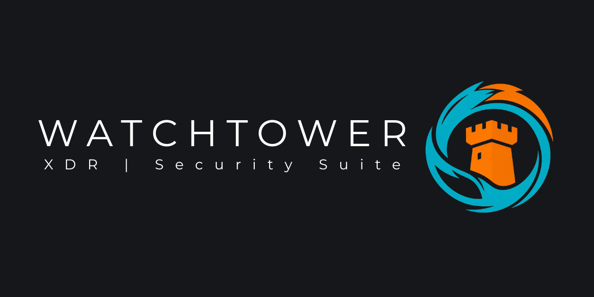

# WatchTower XDR

<div align="center">
  
<p align="center">
  
</p>

  **Self-hosted, explainable detection and response for small Linux server fleets.**

  <p align="center">
    <a href="https://github.com/EForce11/WatchTower/actions/workflows/ci.yml"></a>
    <a href="https://github.com/EForce11/WatchTower/actions/workflows/codeql.yml"></a>
    <a href="https://go.dev/"></a>
    <a href="https://www.gnu.org/licenses/gpl-3.0"></a>
    <a href="https://github.com/EForce11/WatchTower/releases"></a>
  </p>

</div>

---

## What is WatchTower XDR?

WatchTower is an **open-source, self-hosted XDR (Extended Detection and Response)** platform for small-to-medium Linux server fleets (VPS, bare metal, hybrid; roughly 1–200 hosts). Agents collect host, application and network telemetry into one normalized event model. Core correlates weak signals **across layers and across hosts** and responds with bounded, reversible actions. Anything destructive needs a human.

What sets it apart from per-host tools like Fail2Ban:

- **Fleet immunity:** an attack detected on one host becomes a block on every host.
- **One event model:** auth, web, process, file and network events share one schema with entities (host, user, process, IP, file).
- **Detection-as-code:** rules are Sigma-compatible YAML, and each rule ships with positive and negative test samples.
- **Deterministic authority:** a rule-based policy engine decides every action. AI is optional and advisory only.
- **Bounded risk:** every automated action has a TTL. Destructive actions (kill process, isolate host, permanent ban) need an administrator's signature that Core cannot produce.

> **Status:** Pre-alpha, single maintainer. The architecture was redesigned in **v3.2** (see [docs/architecture.md](docs/architecture.md)), and the code is moving from the `v0.2.0` prototype to that design. See the [Roadmap](#roadmap).

---

## Architecture

```
┌──────────────────────── Protected host ──────────────────────────┐
│  wt-sentry  (unprivileged)          wt-turret  (root, no network)│
│  - log watcher → normalized events  - self-preservation rules    │
│  - read-only FIM + package verify   - signature & replay checks  │
│  - process / network telemetry      - nftables table + rollback  │
│  - local Sigma rules  ── reflex ──► - verified process kill      │
└──────────────┬───────────────────────────────────────────────────┘
               │ gRPC / mTLS (agent-initiated)
┌──────────────▼──────────────── Core host ────────────────────────┐
│  wt-core                                                         │
│  - CSR enrollment CA, ingest, heartbeat, command stream          │
│  - entity correlator + deterministic scoring (tiers T0–T3)       │
│  - fleet immunity, baselines, CTI feeds                          │
│  - signs reversible network actions only                         │
│  Web Console · PostgreSQL + TimescaleDB · wt-frontal (opt. AI)   │
└──────────────┬───────────────────────────────────────────────────┘
               │ WireGuard
┌──────────────▼──────────── Administrator ────────────────────────┐
│  browser console (passkeys) · wt-cli (admin key) · ntfy          │
└──────────────────────────────────────────────────────────────────┘
```

For full architecture details, see [docs/architecture.md](docs/architecture.md). Earlier revisions are in [docs/archive/](docs/archive/).

---

## Features

### ✅ Done (v0.4.0, Phase 1: `wt-turret`)
- Root enforcement daemon on a Unix socket (`SO_PEERCRED`), single-instance lock, `panic-flush` rollback
- Safety layer: self-preservation ranges, overlap refusal, origin×action policy, Reflex budget and /24 limiter
- Ed25519-signed commands with a persistent replay cache; Core-signed IOC bundle
- nftables enforcement with bans that never shorten and survive restarts; PID-reuse-safe kills
- Real-kernel tests in unprivileged network namespaces, also in CI

### ✅ Done (v0.3.0, Phase 0: contracts)
- `synapse.v1` protobuf contracts (`buf`), event validation and IPC framing
- TimescaleDB schema migrations with an owner/runtime role split
- Sigma rule layout with structural validation
- CI gates: lint, proto drift, static build, race tests, integration and migration tests

### ✅ Done (v0.2.0 prototype)
- gRPC agent ↔ core communication with heartbeat
- Automatic reconnection with exponential backoff, graceful shutdown
- Log file watcher (`fsnotify`), regex pattern matcher and `/proc` metrics collector, with unit tests
- Integration test suite

The prototype's log watcher and pattern matcher are migrated to the v3.2 design in Phase 2. The regex patterns become Sigma rules, and the log watcher will emit normalized events.

### 🔲 Planned (v3.2 roadmap)
| Phase | Focus | Target |
|-------|-------|--------|
| 0 | Contracts: protobuf schemas, SQL migrations, rule layout | v0.3.0 |
| 1 | `wt-turret`: safety layer, signed commands, nftables | v0.4.0 |
| 2 | `wt-sentry`: normalized events, Sigma engine, FIM, reflex arc | v0.5.0 |
| 3 | `wt-core`: enrollment, correlation, scoring, **fleet immunity**, demo stack | v0.6.0 |
| 4 | `wt-cli` + human-in-the-loop approvals | v0.7.0 |
| 5 | **Web Console**: incidents, fleet, bans, approvals, live attack map | v0.8.0 |
| 6 | Process telemetry: auditd and eBPF collectors | v0.9.0 |
| 7 | Baselines and anomaly signals | v0.10.0 |
| 8 | Installer, hardening, production release | v1.0.0 |
| 9 | Optional AI analyst, CTI feeds, decoys | v1.1+ |

---

## Quick Start

### Prerequisites

| Tool | Version | Purpose |
|------|---------|---------|
| Go | 1.26+ | Build toolchain |
| buf | v1.50.0 | Lint and generate protobuf (`make dev-deps`) |
| make | Any | Build automation |

### Install

```bash
# Clone the repository
git clone https://github.com/EForce11/WatchTower
cd WatchTower

# Install Go code generation tools
make dev-deps

# Build all binaries
make build
```

### Run

```bash
# Terminal 1 — Start the central server
make run-core

# Terminal 2 — Start a monitoring agent
make run-sentry

# You should see heartbeats logged every 10 seconds
```

### Test

```bash
# Run all unit and integration tests
make test

# Run integration test only
make integration-test

# Run integration test with race detector
make integration-test-race

# Run the full CI gate locally (proto-check, build, lint, test)
make verify

# Run the Turret nftables tests in an unprivileged network namespace
make test-netns
```

### Turret emergency rollback

`wt-turret` bans through its own nftables table and re-applies the persisted bans (`<state_dir>/bans.json`) on every start. If a ban ever locks you out (no config needed):

```bash
sudo systemctl stop wt-turret            # or stop the process
sudo ./wt-turret panic-flush --clear-state
# fix the cause of the lockout, then start wt-turret again
sudo systemctl start wt-turret
```

`--clear-state` also renames `bans.json` to `bans.json.flushed-<unix seconds>` (kept for forensics; `--state-dir DIR` overrides the default `/var/lib/watchtower/turret`). Without it the table is removed but the bans come back on the next start. Stop the daemon first: while it runs, its firewall calls fail because the table is gone.

---

## Project Structure

```
WatchTower/
├── cmd/
│   ├── wt-core/         # Central server
│   ├── wt-sentry/       # Monitoring agent
│   └── wt-cli/          # Management CLI (stub)
├── proto/               # Protobuf sources (watchtower/synapse/v1)
├── internal/
│   ├── config/          # Configuration loading
│   ├── core/store/      # SQL migrator and database bootstrap
│   ├── rules/           # Rule layout and WES mapping validation
│   └── sentry/          # Log watcher, pattern matcher, metrics
├── pkg/
│   └── synapse/v1/      # Generated protobuf/gRPC code and IPC framing
├── deployments/
│   └── sql/             # Embedded SQL bootstrap and migrations
├── rules/               # Detection rules and WES field mapping
├── configs/             # Example configuration files
├── test/
│   └── integration/     # End-to-end integration tests
├── docs/                # Architecture (v3.2) and archived revisions
└── scripts/             # Developer helper scripts
```

The target layout (`cmd/wt-turret` and the remaining packages) and the plan for each existing package are in [§8 of the architecture document](docs/architecture.md#8-migration-from-the-current-codebase).

---

## Development

See [docs/architecture.md](docs/architecture.md) for full architecture documentation.

See [CONTRIBUTING.md](CONTRIBUTING.md) for contribution guidelines, branch naming, and commit conventions.

---

## Roadmap

- [x] v0.2.0 prototype: gRPC communication, heartbeat, log watcher
- [x] Phase 0: Contracts (protobuf schemas, SQL migrations, rule layout) (v0.3.0)
- [x] Phase 1: `wt-turret` safety-first enforcement (v0.4.0)
- [ ] Phase 2: `wt-sentry` normalized telemetry and local detection
- [ ] Phase 3: `wt-core` correlation and fleet immunity
- [ ] Phase 4: `wt-cli` and human-in-the-loop approvals
- [ ] Phase 5: Web Console (embedded in `wt-core`, passkey login and approvals)
- [ ] Phase 6: Process telemetry (auditd, eBPF)
- [ ] Phase 7: Baselines and anomaly signals
- [ ] v1.0.0: Production release
- [ ] v1.1+: Optional AI analyst, CTI feeds, decoys

Details and verification gates for each phase: [docs/architecture.md §7](docs/architecture.md#7-development-roadmap).

---

## Contributing

WatchTower is an open project. Contributions, bug reports, and feature requests are welcome.
Please read [CONTRIBUTING.md](CONTRIBUTING.md) before opening a pull request.

---

## Security

If you discover a security vulnerability, **do not open a public issue.**
Please follow the responsible disclosure process described in [SECURITY.md](SECURITY.md).

---

## License

WatchTower XDR is free software: you can redistribute it and/or modify it under the terms of the
[GNU General Public License v3.0](LICENSE) as published by the Free Software Foundation.

---

## Author

**Emir Furkan Ulu**
GitHub: [@EForce11](https://github.com/EForce11)

---

<div align="center">
<sub>WatchTower XDR — Security you can trust, infrastructure you control.</sub>
</div>
